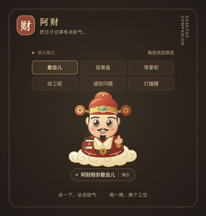

# 阿财 · DSH 财神桌面宠物

阿财是一位红衣描金、脚踩祥云的小财神。DSH 工作时拨算盘，需要你拿主意时举牌，一轮任务结束时抱元宝作揖。首版使用独立的 macOS 透明悬浮窗口，切换到编辑器、浏览器或最小化 DSH 后仍能看到他。

中文名为「阿财」，拼音标识为 `acai`，英文显示名为 **Acai**。

项目为第三方插件，与 [财神主题](https://github.com/MrGuang123/dsh-theme-caishen) 配套，也可独立使用。当前预发布版本 **0.2.0-rc.1**，适配 **DSH 0.2.1-rc.2、macOS 13+**。安装包已包含 Apple Silicon／Intel 通用原生程序，正常安装无需自行编译或安装 Xcode。Windows／Linux 暂不支持桌面宠物；其它 DSH 版本未验证。



上图由当前版本的角色与界面代码直接截取，展示阿财的空闲形象；演示不代表真实 DSH 任务状态。原生运行时背景透明，不显示演示画布边框。

## 已实现

- AppKit + WKWebView 原生透明悬浮窗，不依赖另一套 Electron。
- 原创 SVG 阿财、运行／等待／本轮结束／问题／空闲／离线状态，以及摸头与打盹。
- 宿主侧真实 DSH 状态观察；完成依据 `turn/end` 原因，停止输出不会直接判为成功。
- 点击任务气泡请求回到对应 DSH 会话，不代替用户审批或发送消息。
- 点击主题「功德 +1」时，宠物可见的阿财会蹦一枚金币；不读取或修改功德计数。
- 拖动、多屏位置夹取、位置记忆、尺寸、安静模式、减少动画。
- 原生以鼠标按下时的位置为锚点跟随，停住不漂移；松开检测不依赖网页事件。
- 左右拖动按宠物和工具栏实际范围计算，透明留白不占边界；靠边时设置与气泡向屏幕内展开。
- 悬停时点击返回箭头，唤回 DSH 上次选中的聊天；与当前任务的状态气泡导航独立。
- 透明空白区域鼠标穿透；菜单栏唤回与 `Control + Option + Command + A` 显示／收起。
- 本地开工签；默认无声，无额外模型请求、遥测或远程素材。
- 插件停用与宿主进程退出清理；原生窗口有父进程和本机健康监测。

## 0.2 预发布版的 2D 增强

本版新增按轮次绑定的任务气泡、多任务列表、单次庆祝与提醒消退、提醒分级／暂静 30 分钟、迷你／大字、动作变化、位置锁定／停靠／重置、可配置唤回字母、渲染恢复和最小诊断。快捷键修饰键保持 Control + Option + Command，可选 A–Z 或停用。3D 排在本阶段验收后。

气泡已改为圆角，移除底部「∨」尖角，短消息不再出现多余滚动条，长消息按需滚动。HTTP 状态升级为 v2，Native 握手升级为 4，安装包包含同步重建的原生程序。

本版为预发布，整体 2D 阶段尚未完成全部实机验收；完整 DSH 界面流程、Intel、多屏、连续拖动等边界见 [验证记录](docs/VALIDATION.md)。既有稳定版仍为 0.1.0。

## 安装

### 从 GitHub 安装到 DSH

1. 打开 DSH 侧栏「插件」→「添加插件」。
2. 填写以下完整地址，点击「安装」：

   ```text
   git+https://github.com/MrGuang123/dsh-pet-caishen.git#v0.2.0-rc.1
   ```

3. 安装完成后点击「立即启用」，按 DSH 提示刷新或完全退出后重启。
4. 阿财会出现在桌面。DSH 首页或会话工具栏的「今日财运在线」可收起阿财，再次点击灰色「财运正在路上」可唤回。

GitHub 地址必须能从本机访问；切换 npm 镜像不能替代 GitHub 下载。DSH 的安装方式见 [官方插件管理说明](https://github.com/deepseek-ai/deepseek-harness/blob/master/packages/client/ui-plugin-manager/README.zh.md)。

也可以在 [Releases](https://github.com/MrGuang123/dsh-pet-caishen/releases) 下载 `dsh-pet-caishen-0.2.0-rc.1.tgz`，在「添加插件」中填写该文件的绝对路径。Release 同时提供 `SHA256SUMS`。GitHub 自动生成的源码 ZIP 解压后，也可填写插件目录的绝对路径。

使用已配置 CLI profile 的用户可以运行：

```bash
dsh plugin --profile web add 'git+https://github.com/MrGuang123/dsh-pet-caishen.git#v0.2.0-rc.1'
```

将 `web` 换成实际的 CLI profile 名称；桌面端用户建议直接使用插件页面。

### 使用、更新与卸载

- 悬停阿财显示求签、返回刚才聊天和设置按钮；任务气泡可以打开对应任务。
- 拖动阿财调整位置；右键打开设置，可调整大小、安静模式和减少动画。
- 菜单栏「财」、快捷键 `Control + Option + Command + A` 与 DSH 财运开关均可显示／收起。
- 退出 DSH 后阿财跟随退出。暂时停用、卸载请使用 DSH 插件管理页。
- 更新时查看新版发布说明，在 DSH 中卸载旧包后用新版标签地址安装，并完全退出重启 DSH。位置与外观偏好会保留；本插件不提供后台自动更新。

首次出现较晚时可等几秒，再点击财运开关。若开关提示原生程序缺失，请重新安装完整插件；若 macOS 阻止启动，请查看系统给出的具体原因，并在 [Issues](https://github.com/MrGuang123/dsh-pet-caishen/issues) 附上系统版本、CPU、DSH 版本和错误文字。预编译程序采用 ad-hoc 签名，尚未进行 Developer ID 公证；也可按下面的源码构建步骤自行编译。

## 本地开发与预览

需要 Node.js 22+，无须安装 npm 运行依赖：

```bash
npm run dev
```

终端会给出仅在本机有效的登录链接，打开后进入明确标注的**演示模式**。可以切换六种业务状态；演示不代表已经连接真实 DSH。`Ctrl+C` 停止服务。

### 构建与原生演示

需要 macOS 13+ 与 Xcode Command Line Tools：

```bash
npm run build:macos
npm run start:macos
```

编译产物为 `build/Acai.app`，构建当前机器 CPU 架构并使用本地 ad-hoc 签名。`start:macos` 启动原生演示窗口；它仍属于演示模式，`Ctrl+C` 同时结束窗口和服务。App 由插件或演示命令传入会话配置，**不要直接双击未配置的 App**。

源码开发优先使用本地 `build/Acai.app`，GitHub 安装使用 `native/Acai.app`。修改 Swift 后需要重建；宿主会校验原生协议。发布者使用 `npm run prepare:native` 生成双架构分发程序和摘要，详见 [发布流程](docs/RELEASING.md)。

## 数据与兼容性

网页设置仅保存外观、提醒和桌面控制偏好；任务事实仅驻内存，macOS 窗口位置保存在独立 UserDefaults。macOS 插件偏好位于 `~/Library/Application Support/dsh-pet-caishen/preferences.json`，不会保存会话标题或正文。停用插件不主动删除这些偏好。

阿财只接收 live root 任务的标题、状态和交互标志，不读取模型推理、消息内容、工具参数或财务统计。桥接只监听随机 loopback 端口，使用临时登录凭证与同源操作限制。

主题中的功德计数暂未接入；本插件不修改财神主题、其提示词或功德数据。锁屏、安全界面和部分全屏独占行为由系统控制；多屏与全屏实机边界见验证文档。

自动检查覆盖无 `build/` 的干净安装包、原生程序完整性与宿主接口；本机实窗验证环境为 Apple Silicon。Intel 已交叉编译并检查二进制，尚未完成 Intel 实机交互验收。详细结果见 [验证记录](docs/VALIDATION.md)。

## 开发文档

- [产品共识与范围](docs/PRODUCT.md)
- [当前阶段需求与验收标准](docs/REQUIREMENTS.md)
- [实施步骤与后续 3D 阶段](docs/IMPLEMENTATION_PLAN.md)
- [架构与目录](docs/ARCHITECTURE.md)
- [任务、提醒与设置契约](docs/STATE_CONTRACT.md)
- [桥接协议](docs/PROTOCOL.md)
- [开发与打包](docs/DEVELOPMENT.md)
- [版本发布流程](docs/RELEASING.md)
- [验证与已知边界](docs/VALIDATION.md)
- [素材说明](docs/ARTWORK.md)

MIT License。
